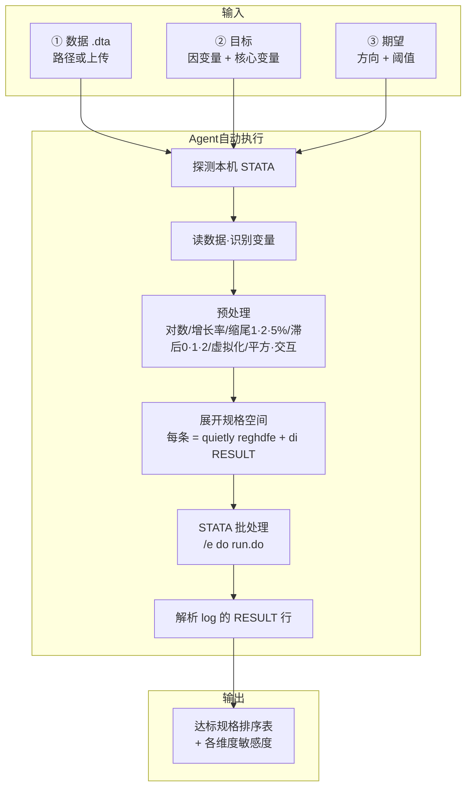

# stata-spec-search

> 让 AI 编程代理帮你做 STATA 实证的**规格搜索（Specification Search）**与**极端边界分析（Extreme Bounds Analysis, EBA）**——你说目标，它自动遍历设定、调用本机 STATA 真实回归、交出显著规格排序表。

[](LICENSE)
[]()


---

## 目录

1. [这是什么](#这是什么)
2. [解决什么问题](#解决什么问题)
3. [工作原理](#工作原理)
4. [快速开始](#快速开始)
5. [如何使用](#如何使用)
6. [规格空间](#规格空间)
7. [输出示例](#输出示例)
8. [目录结构](#目录结构)
9. [学术规范](#学术规范)
10. [License](#license)

---

## 这是什么

一个 **Agent Skill**（兼容 Claude Code / Codex CLI / opencode / Gemini CLI / DSH / zcode 等）。
加载后，agent 会替你把"实证不显著 / 审稿人质疑结论稳健性"这件事做成一次系统性的设定遍历：

1. 探测本机 STATA（Windows / macOS / Linux）
2. 缺失时自动安装 `reghdfe` / `ftools`
3. 自动生成候选变量（对数、增长率、缩尾、滞后、虚拟化、交互项）
4. 展开所有设定组合，每个规格跑一次真实回归
5. 标出达到统计显著性且方向与假设一致的规格，按 p 排序输出
6. 出错了自己排查（`r(111)` / `r(198)` / `r(2000)` …），修复后重跑

## 解决什么问题

实证回归的结论对分析设定高度敏感：换一个因变量口径、换一个核心变量代理、
加减一个控制变量、换一套固定效应或标准误层级、换单尾双尾，p 值就可能翻个跟头。

- **结果不显著**，想知道"换个合理设定能不能出来"，但手工试几十上百个组合很痛苦；
- **审稿人质疑**"结论是不是挑出来的"，需要系统遍历设定来回应；
- 与其一个个手试，不如让 agent 自动遍历全部组合、调用本机 STATA 真实跑回归、把结果摆出来。

## 工作原理



核心原则：**样本固定不动，只在设定层面搜索**。每个规格就是一次回归 + 一行 `RESULT|...`，
代码保持最简（不用 postfile / 动态宏 / 复杂命令），agent 容易生成、容易排查。

## 快速开始

### 方法一：让 agent 帮你装（推荐）

直接对任意兼容的 agent 说：

> 请安装这个 Agent Skill：`https://github.com/qiufeng662/stata-spec-search`
> 按你当前所在的 agent 环境，把它放到正确的 skills 目录，装完告诉我怎么触发。

agent 会自己判断环境（Claude Code / Codex / opencode / …）、clone 到对应目录并验证。

### 方法二：手动安装

把本仓库放到目标 agent 的 skills 目录。目录名 = skill 名，须与 `SKILL.md` frontmatter 的 `name` 一致。

| Agent | 个人级 skills 目录 |
|---|---|
| Claude Code | `~/.claude/skills/` |
| Codex CLI | `~/.codex/skills/` |
| opencode | `~/.config/opencode/skills/` |
| Gemini CLI | `~/.gemini/skills/` |
| DSH | `~/.dsh/skills/` |

```bash
# Claude Code 示例
git clone https://github.com/qiufeng662/stata-spec-search ~/.claude/skills/stata-spec-search

# Codex CLI 示例
git clone https://github.com/qiufeng662/stata-spec-search ~/.codex/skills/stata-spec-search
```

更多细节见 [INSTALL.md](INSTALL.md)。

## 如何使用

### 触发语

> 帮我做一下这个面板回归的规格搜索，数据在 `mydata.dta`，因变量是 roa，核心变量是 dig，想要正向显著。

或简化为任意一种：

- "规格搜索" / "specification search" / "极端边界分析" / "EBA"
- "哪种设定下结果显著" / "排查设定敏感性" / "模型选择"

### 你只需要提供三样

| 输入 | 说明 |
|---|---|
| **数据** | `.dta` 路径（或直接上传） |
| **目标** | 因变量是什么、核心解释变量是什么 |
| **期望** | 系数方向（正/负）、显著性阈值（默认 0.05） |

**不需要**写代码、不需要做预处理、不需要懂 STATA 命令——预处理、写 do、跑回归全由 agent 完成。

### 如果你已有实证 do 文件

直接上传或给路径，agent 会读它识别因变量 / 核心变量 / 控制变量 / 固定效应 / 标准误，
**在你原有回归设定的基础上**扩展规格搜索，原设定原样保留。

### 你会拿到什么

1. **达标规格排序表**：p 值从低到高，含完整设定配方（因变量 / 核心变量 / 控制变量 / 固定效应 / 标准误）
2. **各维度达标率分布**：哪个维度（比如缩尾、滞后、单双尾）最能把结论翻过来
3. **最敏感维度**：结论对哪个自由度最脆弱——那就是审稿人会打的点

## 规格空间

样本固定不动，遍历六个自由度：

| 维度 | 覆盖 |
|---|---|
| 因变量 | 多口径（roa / 托宾Q / 收益率）+ 变换（对数/增长率/差分/标准化）+ 缩尾（1%/2%/5%）+ 虚拟化 |
| 核心解释变量 | 多代理 + 滞后（0/1/2 期）+ 变换 + 高-低组虚拟化 |
| 控制变量 | 多套组合 + 高阶项（平方项 / 交互项） |
| 固定效应 | 无 / `firm` / `year` / `firm year` / `ind year` |
| 标准误 | OLS / robust / cluster(firm) / cluster2(firm, year) |
| 推断选择 | 单尾 / 双尾 + 显著性阈值 α（0.01 / 0.05 / 0.10） |

变换 / 滞后 / 缩尾 / 虚拟化 / 高阶项在数据准备阶段**预生成成候选变量列**再进枚举——样本不剔除、不截尾。

## 输出示例

```
规格总数: 720   达标(hit): 128   达标率: 17.8%
Bonferroni 校正后仍达标(方向一致): 36

==== 达标规格（按 p 升序） ====
y    x    ctrl                 fe         se              beta     p
roa  dig  size lev cash        firm year  cluster2(...)  0.0063  0.0008
roa  dig  size lev cash growth firm year  cluster2(...)  0.0063  0.0008
...
```

## 目录结构

```
stata-spec-search/
├── README.md
├── LICENSE
├── INSTALL.md            # 各 agent 详细安装说明
├── SKILL.md              # 核心 skill（Agent Skills 格式）
├── do/
│   ├── spec_search.do    # 简单格式模板（reghdfe + RESULT 行）
│   └── demo_data.do      # 生成演示合成面板（含候选变量）
└── examples/
    └── README.md         # 交互示例 + 手动跑格式
```

## 学术规范

本工具属于模型选择（model selection）与极端边界分析（EBA），
Leamer (1983) 以来计量经济学的标准方法——它遍历并**报告所有规格**，
而不是帮你隐藏不显著的结果。

显著规格只是模型选择的候选，最终需结合理论与研究设计判断。
报告时建议附：搜索空间规模、specification curve、多重检验校正
（Bonferroni / Romano-Wolf），避免过度拟合。

## License

[MIT](LICENSE)
